# Relatório Técnico — Tech Challenge Fase 1

**Equipe:** Guilherme Saar Santos, Wesley Berto, Michel Zarif, Luis Felipe Laudacio e Sara Felix
**Repositório:** <https://github.com/team-tech-challenge-fiap/tech-challenge-2026-fiap>
**Vídeo:** <https://youtu.be/3EhuysvC3Gg>

## 1. Problema

As doenças cardiovasculares são a principal causa de morte no mundo, segundo a Organização Mundial da
Saúde. Muitos casos só são descobertos quando já há sintomas graves, porque o diagnóstico depende de exames
que nem sempre estão ao alcance de todos os pacientes.

Este projeto constrói um modelo de **triagem**: a partir de dados simples, que qualquer consulta de rotina
coleta (idade, sexo, altura, peso, pressão arterial, colesterol, glicose e hábitos de vida), ele estima se o
paciente tem doença cardiovascular. O objetivo não é diagnosticar, e sim **priorizar** quais pacientes devem
fazer exames mais completos primeiro. Por isso o erro mais grave é o falso negativo (um doente classificado
como saudável), e o **recall** é a métrica mais importante, acompanhado de precision, F1 e AUC. O médico
mantém a decisão final.

## 2. Dataset

Os dados são do *Cardiovascular Disease Dataset*, do Kaggle
(<https://www.kaggle.com/datasets/sulianova/cardiovascular-disease-dataset>): **70.000 pacientes** e 13
colunas (arquivo `data/raw/cardio_train.csv`, separador `;`). O `id` é só um identificador e `cardio` é o
alvo (1 = doença cardiovascular), o que deixa **11 variáveis** para o modelo, de três tipos:

| Tipo | Variáveis | Observação |
|---|---|---|
| **Objetivas** | idade, sexo, altura, peso | medidas ou registradas pela clínica; a idade vem em dias e é convertida para anos |
| **De exame** | pressão sistólica e diastólica, colesterol, glicose | pressão em mmHg; colesterol e glicose em 3 níveis (normal, acima, muito acima) |
| **Subjetivas** | fumo, álcool, atividade física | **autodeclaradas** (sim/não), logo menos confiáveis |

O alvo é **balanceado**: 35.021 pacientes sem doença e 34.979 com doença (≈ 50% / 50%). Por isso a acurácia
também é informativa e não foi preciso reamostrar. Os pacientes têm de 29,6 a 64,9 anos, e 65% são mulheres.
Não há valores ausentes. O principal problema do dataset é a **qualidade dos registros** (seção 3).

## 3. Exploração de dados

Os detalhes ficam nos notebooks `01_eda_visao_geral.ipynb` (T03), `02_eda_demografia_imc.ipynb` (T04),
`03_eda_pressao_arterial.ipynb` (T05), `04_eda_exames_habitos.ipynb` (T06) e `08_eda_correlacao.ipynb`
(T07); as figuras estão em `results/figures/`.

### 3.1 Problemas de qualidade

- **Duplicados:** 24 linhas idênticas se ignorarmos o `id` (48 registros). Mantê-las colocaria o mesmo
  paciente no treino e na validação, inflando o resultado.
- **Pressão arterial impossível:** a sistólica vai de −150 a 16.020 mmHg e a diastólica de −70 a 11.000, e
  há pacientes com diastólica maior ou igual à sistólica.
- **Altura e peso fora da realidade:** altura de 55 a 250 cm e peso a partir de 10 kg, além de combinações
  que dão um IMC impossível.
- **Tratamento (T08):** `clean()` remove os registros com erro, em vez de corrigi-los, usando as faixas
  plausíveis do `config.py`. O dataset passa de **70.000 para 68.509 linhas** (1.491 removidas, 2,1%), e a
  taxa de doença quase não muda (≈ 50%), então a limpeza não enviesa o alvo.
  Figuras: `t03_alvo.png`, `t03_faixas.png` e `t03_limpeza.png`.

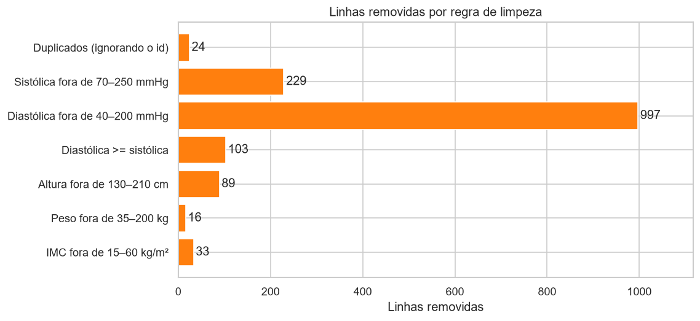

### 3.2 O que se relaciona com a doença

Os números abaixo são sobre os 68.509 pacientes limpos; a taxa de doença é a proporção com `cardio = 1`.
As correlações são de Pearson, como na T07. Figuras: `t07_ranking_alvo.png` (correlação de cada variável com a
doença), `t07_taxa_por_faixa.png` (taxa de doença por faixa de idade e de pressão, que mostra a forma da relação)
e `t06_colesterol_glicose.png` (colesterol e glicose).

| Fator | Achado |
|---|---|
| **Pressão arterial** (o fator mais forte) | Sistólica e diastólica são as variáveis mais correlacionadas com o alvo (correlação de Pearson de 0,43 e 0,34). Pela classificação ACC/AHA, a taxa de doença é de 22% com pressão normal, 32% na elevada, 39% na hipertensão 1 e **78% na hipertensão 2**. |
| **Idade** | A doença cresce de forma contínua com a idade: 24% até 40 anos, 43% entre 45 e 50, 56% entre 55 e 60 e **67% depois dos 60** (correlação de 0,24). |
| **Colesterol** | 44% de doença com colesterol normal, 60% acima do normal e **76% muito acima** (correlação de 0,22). A glicose segue o mesmo sentido, mais fraca: 48%, 59% e 62% (0,09). |
| **Peso e IMC** | A taxa é de 27% abaixo do peso, 40% no peso normal, 51% no sobrepeso e **63% na obesidade** (correlação do IMC de 0,19). A altura isoladamente não tem relação (−0,01). |
| **Sexo** | Praticamente nenhuma: 49% das mulheres e 50% dos homens têm doença (correlação de 0,01). Vale a pena lembrar que 65% da amostra são mulheres. |
| **Hábitos** | Efeito fraco e, no fumo e no álcool, **contrário ao esperado**: 47% de doença entre fumantes contra 50% entre não fumantes. Quem faz atividade física tem 49% contra 53% de quem não faz. |

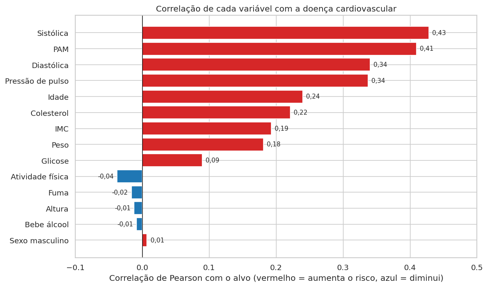

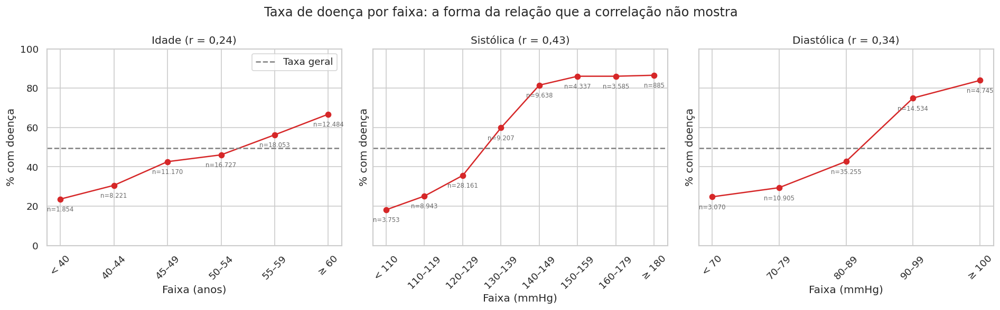

A segunda figura mostra o que a correlação não capta: a idade sobe de forma contínua, mas a pressão sistólica tem um
degrau entre 120 e 140 mmHg e se estabiliza acima de 140, nos mesmos cortes usados na prática clínica.

### 3.3 Cuidados com a interpretação

- **Hábitos autodeclarados não são confiáveis.** O resultado "fumar protege o coração" não indica que fumar
  faça bem: o sinal vem de como a variável foi coletada (subnotificação, quem parou de fumar depois do
  diagnóstico e uma medida só de sim/não). A T06 testou o efeito de sexo e idade e ele explica só uma parte (figuras `t06_habitos.png` e
  `t06_fumo_estratificado.png`).
  Essas variáveis ficam no modelo pelo valor preditivo, mas o efeito delas **não deve ser lido como causal**.
- **Nenhuma variável isolada separa os grupos:** mesmo a pressão, a mais forte, deixa 22% de doentes entre
  quem tem pressão normal. Isso explica o teto de desempenho dos modelos (acurácia em torno de 73%, AUC em
  torno de 0,79) e é discutido na análise de erros (T26).
- **Não há vazamento de dados (T07):** o `id` não tem relação com a doença (correlação de 0,004 e AUC de 0,50
  usando só o `id`) e fica fora das variáveis do modelo, e nenhuma variável é consequência direta do
  diagnóstico. A falta de informação sobre o tratamento do paciente é uma limitação do dataset, e não vazamento.

## 4. Estratégias de pré-processamento

O pré-processamento transforma o arquivo bruto (70.000 pacientes) em dados prontos para os modelos. Ele tem
quatro etapas: limpeza dos registros impossíveis, conversão e criação de variáveis, divisão em treino,
validação e teste, e preparação das variáveis dentro do pipeline de cada modelo. Todas usam as mesmas
funções do código (`clean()`, `load_splits()` e `build_preprocessor()`), então os cinco integrantes treinaram
os modelos sobre exatamente os mesmos dados.

### 4.1 Limpeza: registros impossíveis e duplicados (T08)

O dataset não tem valores ausentes, mas tem **valores fisiologicamente impossíveis**, típicos de erro de
digitação: pressão sistólica de −150 ou 16.020 mmHg, diastólica de 11.000 mmHg, adultos com 55 cm de altura
ou 10 kg de peso. Esses registros foram **removidos**, e não corrigidos: na maioria dos casos não há como
saber qual era o valor certo (um "1100" pode ser 110 ou 100), e corrigir por suposição colocaria no modelo
dados inventados. As faixas aceitas foram definidas nas análises exploratórias (T04 e T05):

| Regra (aplicada em sequência) | Faixa aceita | Justificativa clínica | Linhas removidas |
|---|---|---|---|
| Duplicados | — | Mesmo paciente registrado duas vezes (todas as colunas iguais, exceto o `id`) | 24 |
| Pressão sistólica | 70 a 250 mmHg | Abaixo de 70 indica choque circulatório; acima de 250 é extremamente raro e, aqui, eram erros de digitação | 229 |
| Pressão diastólica | 40 a 200 mmHg | Fora disso são valores digitados com zeros a mais ou negativos | 997 |
| Diastólica < sistólica | — | A pressão "de baixo" nunca é maior ou igual à "de cima" | 103 |
| Altura | 130 a 210 cm | Adultos fora dessa faixa são raríssimos; os casos encontrados eram erros | 89 |
| Peso | 35 a 200 kg | Abaixo de 35 kg é incompatível com adultos dessas alturas | 16 |
| IMC | 15 a 60 kg/m² | Pega combinações de altura e peso impossíveis que passam nas regras anteriores | 33 |
| **Total** | | | **1.491 (2,1%)** |

As regras são aplicadas uma após a outra, e cada linha da tabela conta só os registros que aquela regra
removeu, por isso a soma bate com o total. Os **24 duplicados** (registros com todas as informações iguais,
mudando só o número de identificação) foram removidos primeiro, para que o mesmo paciente não apareça ao
mesmo tempo no treino e no teste, o que inflaria artificialmente o resultado.

Depois da limpeza ficam **68.509 pacientes**. A proporção de doentes praticamente não muda (de 49,97% para
49,49%), o que mostra que os registros removidos estavam espalhados entre os dois grupos e a limpeza não
desequilibrou as classes. As faixas ficam centralizadas no código (`config.py`), e testes automatizados
confirmam que nenhum valor fora delas sobra depois da limpeza.

### 4.2 Conversões e variáveis derivadas (T02 e T10)

Duas colunas mudam de formato: a **idade**, que vem em dias no arquivo original, é convertida para anos, e o
**sexo** (1 = mulher, 2 = homem) vira uma variável `sex_male` (1 = homem, 0 = mulher), mais fácil de
interpretar. O identificador do paciente nunca é usado como variável.

Além das variáveis originais, foram criadas cinco **variáveis derivadas** com significado clínico. Elas são
calculadas só a partir das próprias medidas do paciente, nunca a partir do diagnóstico, por isso não "entregam
a resposta" ao modelo:

| Variável | Como é calculada | Por que pode ajudar |
|---|---|---|
| IMC | peso ÷ altura² | Resume peso e altura num único indicador de excesso de peso, fator de risco conhecido |
| Pressão de pulso | sistólica − diastólica | Diferença alta indica rigidez das artérias, comum no envelhecimento vascular |
| Pressão arterial média (PAM) | (sistólica + 2 × diastólica) ÷ 3 | Representa a pressão com que o sangue chega aos órgãos |
| Categoria de pressão | Normal, elevada, hipertensão 1 ou 2 (diretriz ACC/AHA 2017) | Traduz os números na classificação usada na prática médica |
| Faixa de IMC | Abaixo do peso, normal, sobrepeso ou obesidade (OMS) | Idem, para o peso |

Com isso, cada modelo foi treinado com dois **conjuntos de variáveis**: o **A**, com as 11 variáveis originais
já limpas (idade, sexo, altura, peso, pressões, colesterol, glicose, fumo, álcool e atividade física), e o **B**,
com o A mais as 5 derivadas. Comparar os dois mostra se a engenharia de variáveis traz ganho real. Nos
resultados (seção 6), a diferença entre A e B ficou abaixo de 0,01 de AUC em todos os modelos: as derivadas
são combinações das variáveis originais, que os modelos já conseguem aproveitar sozinhos.

### 4.3 Divisão em treino, validação e teste (T09)

Os 68.509 pacientes foram divididos uma única vez, com sorteio fixo (semente 42), em três grupos:

| Conjunto | Pacientes | Proporção | Uso |
|---|---|---|---|
| Treino | 47.955 | 70% | Os modelos aprendem com esses pacientes |
| Validação | 10.277 | 15% | Comparar modelos, escolher hiperparâmetros e o limiar de decisão |
| Teste | 10.277 | 15% | Avaliação final, **usado uma única vez** |

A divisão é **estratificada**: os três grupos têm a mesma proporção de doentes (49,5%), então nenhum fica
mais "fácil" que outro. Ela é sempre a mesma, para todos os integrantes e em qualquer computador, e o grupo de
cada paciente fica registrado em `results/split_ids.csv`.

O **teste só é usado no final** (T23) porque é o único grupo que simula pacientes nunca vistos. Se fosse
usado para escolher o modelo ou ajustar parâmetros, o resultado final ficaria otimista demais, como um aluno
que estuda com as questões da própria prova. Por isso, todas as escolhas (hiperparâmetros, conjunto de
variáveis e limiar) foram feitas com o treino e a validação. A busca de hiperparâmetros usou, além disso,
**validação cruzada de 5 partes dentro do treino**: o treino é dividido em 5 pedaços, e cada combinação é
testada 5 vezes, cada vez deixando um pedaço de fora, o que dá uma estimativa mais estável.

### 4.4 Preparação das variáveis dentro do pipeline (T11)

Antes de chegar ao algoritmo, cada tipo de variável recebe um tratamento:

- **Contínuas** (idade, altura, peso, pressões, IMC, pressão de pulso e PAM): são **padronizadas**, isto é,
  colocadas na mesma escala (média 0 e desvio-padrão 1). Sem isso, modelos baseados em distância ou em
  coeficientes, como KNN e Regressão Logística, dariam mais peso ao peso em kg ou à pressão em mmHg só porque
  os números são maiores. Os modelos de árvore (Random Forest e XGBoost) não precisam disso e recebem os
  valores originais.
- **Ordinais** (colesterol e glicose, em 3 níveis): mantidas como 1, 2 e 3, porque a ordem tem significado
  ("muito acima" é mais que "acima").
- **Binárias** (sexo, fumo, álcool e atividade física): mantidas como 0 e 1.
- **Categorias do conjunto B** (categoria de pressão e faixa de IMC): transformadas em uma coluna de sim/não
  para cada categoria (*one-hot encoding*), porque não são números. Com isso, o conjunto B passa de 16 para
  22 colunas.

Esse tratamento fica **dentro do pipeline de cada modelo**, e não é aplicado na base inteira antes da divisão.
O motivo é evitar o **vazamento de informação**: a padronização usa a média e o desvio-padrão dos dados, e,
se esses valores fossem calculados com todos os pacientes, informações da validação e do teste "vazariam"
para o treino. Dentro do pipeline, eles são calculados só com o treino (e, na validação cruzada, só com o
pedaço de treino de cada rodada) e depois apenas aplicados aos demais pacientes, exatamente como aconteceria
com um paciente novo no hospital.

## 5. Modelos usados e por quê

Foram avaliados cinco algoritmos de aprendizado de máquina para identificar padrões associados à presença de doenças cardiovasculares. A comparação considerou desempenho preditivo, capacidade de identificar pacientes com a doença, interpretabilidade e custo computacional. Como o objetivo é apoiar a triagem, a sensibilidade (*recall*) recebeu atenção especial: um falso negativo representa um paciente com doença que não foi sinalizado pelo modelo.

**Regressão Logística (T15).** Foi utilizada como modelo de referência (*baseline*) por sua simplicidade e interpretabilidade. Seus coeficientes permitem compreender a associação de cada variável com a classificação, por meio de medidas como o *odds ratio*. Foram avaliados diferentes valores de regularização (`C`) e o balanceamento das classes. A configuração definida na T15 foi `C=1` e `class_weight="balanced"`, buscando preservar a capacidade de identificar pacientes positivos.

**K-Nearest Neighbors — KNN (T16).** Classifica um paciente considerando os resultados dos pacientes mais semelhantes presentes no treinamento. Sua inclusão permitiu avaliar uma abordagem baseada em distância, diferente dos modelos lineares e das árvores. Como a distância depende da escala das variáveis, medidas contínuas foram padronizadas. A configuração escolhida utiliza 101 vizinhos com pesos uniformes. Embora o treinamento seja rápido, a previsão exige comparar novos pacientes com os registros armazenados.

**Random Forest (T17).** Combina 300 árvores de decisão para identificar relações complexas entre fatores como idade, pressão arterial e colesterol. Foi escolhido pela capacidade de representar associações não lineares e reduzir a instabilidade de uma árvore isolada. Os experimentos iniciais apresentaram sobreajuste, posteriormente reduzido por limitações na profundidade das árvores e na quantidade mínima de pacientes por folha.

**XGBoost (T18).** Utiliza árvores construídas sequencialmente, de modo que cada nova árvore procure corrigir erros das anteriores. Foi incluído por sua eficiência em dados tabulares e pela capacidade de representar interações entre fatores clínicos. Para controlar o sobreajuste, foram utilizadas árvores de profundidade 4 e taxa de aprendizado de 0,03. O conjunto A apresentou AUC ROC de aproximadamente 0,792 na validação e foi selecionado como modelo final do projeto.

**Support Vector Machine — SVM (T19).** Busca uma fronteira que diferencie pacientes com e sem doença cardiovascular. Para representar relações não lineares sem o elevado custo do kernel RBF exato, foi utilizada a aproximação Nyström, com 500 componentes, seguida de `LinearSVC` calibrado. Essa estratégia apresentou AUC próxima de 0,792 na validação e permitiu aproveitar o conjunto completo de treinamento com menor custo computacional.

### Conjuntos de atributos e engenharia de variáveis

Todos os algoritmos foram avaliados com dois conjuntos de atributos. O **conjunto A** contém 11 variáveis clínicas, demográficas e comportamentais, incluindo idade, sexo, medidas corporais, pressão arterial, colesterol, glicose e hábitos de vida. O **conjunto B** acrescenta cinco variáveis derivadas: índice de massa corporal (IMC), pressão de pulso, pressão arterial média (PAM), categoria de pressão e faixa de IMC.

A comparação mostrou diferenças pequenas de AUC ROC entre os conjuntos A e B, inferiores a 0,01. Portanto, a engenharia de variáveis não produziu ganho expressivo na capacidade de discriminação dos modelos. O conjunto A foi preferido para o modelo final por apresentar desempenho competitivo com menor complexidade.

### Busca de hiperparâmetros e custo computacional

A otimização utilizou `RandomizedSearchCV`, com validação cruzada estratificada em cinco partes, exclusivamente nos dados de treinamento. O principal critério de escolha foi a AUC ROC, que avalia a capacidade de distinguir as duas classes em diferentes limiares de decisão. O pré-processamento foi executado dentro de cada etapa da validação cruzada, evitando vazamento de informações.

Para o KNN, a busca utilizou uma amostra estratificada de 10.000 pacientes, reduzindo o custo das comparações de distância. Para o SVM, foram testadas abordagens lineares, kernel RBF exato em amostra e aproximação Nyström; esta última foi selecionada pelo equilíbrio entre desempenho e tempo de processamento.

| Modelo | Hiperparâmetros principais | Tempo registrado |
|---|---|---|
| Regressão Logística | `C=1`; `class_weight=balanced` | 0,21 s* |
| KNN | `n_neighbors=101`; `weights=uniform` | 0,13 s |
| Random Forest A | `n_estimators=300`; `max_depth=10`; `min_samples_leaf=20`; `max_features=sqrt` | 216,76 s |
| XGBoost A | `n_estimators=200`; `max_depth=4`; `learning_rate=0.03`; `subsample=0.8`; `colsample_bytree=0.8` | 0,52 s |
| SVM A | `C=0.1`; `gamma=0.1`; Nyström com 500 componentes | 29,20 s |

*Nota:* os tempos foram obtidos dos registros disponíveis, mas representam etapas distintas: no Random Forest, o valor inclui a busca de hiperparâmetros; nos demais casos, os registros apresentados correspondem a execuções de treinamento.

Os resultados comparativos podem ser consultados em `results/comparison_table.csv`, e as curvas ROC dos modelos estão disponíveis em `results/figures/roc_A.png` e `results/figures/roc_A_vs_B_xgb.png`.

**Síntese.** Os cinco modelos apresentaram capacidade discriminativa semelhante, mas diferiram em interpretabilidade, custo computacional e comportamento de classificação. O XGBoost com o conjunto A foi selecionado para a etapa final, com ajuste posterior do limiar de decisão para priorizar a identificação de pacientes com doença cardiovascular. Os resultados representam validação experimental interna e não autorizam o uso isolado do sistema para diagnóstico médico.

## 6. Resultados

Esta seção mostra como o modelo foi avaliado e o que ele alcançou. Os números da validação vêm de modelos treinados **apenas com os dados de treino**; o conjunto de teste foi usado **uma única vez**, no final. Todos os valores foram calculados em `notebooks/12_resultados_relatorio.ipynb`.

### 6.1 Como medimos o desempenho

Como o sistema deve apoiar a triagem, cada métrica responde a uma pergunta clínica diferente:

| Métrica | Pergunta que responde | Por que importa aqui |
|---|---|---|
| **Recall** (sensibilidade) | Dos pacientes que têm a doença, quantos o modelo sinaliza? | É a métrica principal: um falso negativo é um doente que sai sem ser visto, o erro mais grave numa triagem. |
| **Precision** | Dos pacientes sinalizados, quantos realmente têm a doença? | Mede os alarmes falsos, que geram consultas e exames desnecessários. |
| **F1-score** | Qual o equilíbrio entre recall e precision? | Resume as duas em um único número. |
| **AUC ROC** | O modelo dá risco maior aos doentes do que aos saudáveis, qualquer que seja o corte? | Compara modelos sem depender do limiar de decisão: 0,5 equivale a sortear e 1,0 é perfeito. |
| **Acurácia** | Qual a porcentagem de acertos? | É informativa porque as classes são equilibradas (cerca de 50% cada), mas não distingue os dois tipos de erro. |

### 6.2 Comparação dos modelos na validação

Os cinco modelos foram avaliados nos mesmos 10.277 pacientes de validação, com o limiar padrão de 0,50. A tabela traz o conjunto A (11 variáveis originais) e, na última coluna, a AUC do conjunto B (com variáveis derivadas).

| Modelo | Acurácia | Precision | Recall | F1 | AUC (conjunto A) | AUC (conjunto B) |
|---|---|---|---|---|---|---|
| XGBoost | 72,6% | 74,5% | 67,9% | 71,1% | 0,792 | 0,792 |
| SVM | 72,8% | 74,1% | 69,3% | 71,6% | 0,792 | 0,791 |
| Random Forest | 72,9% | 75,2% | 67,3% | 71,1% | 0,791 | 0,790 |
| KNN | 72,5% | 75,3% | 66,0% | 70,4% | 0,785 | 0,786 |
| Regressão Logística | 72,7% | 75,0% | 67,1% | 70,8% | 0,783 | 0,785 |
| Baseline (sorteio) | 50,9% | 50,4% | 49,4% | 49,9% | 0,508 | 0,508 |

Todos os modelos aprendem algo real: o baseline acerta cerca de 51%, e os cinco modelos ficam entre 72,5% e 72,9% de acurácia, com AUC entre 0,783 e 0,792. **A diferença entre os modelos é pequena** (menos de 0,01 de AUC), e o conjunto B não melhora nenhum deles (a maior diferença entre A e B é de 0,002). O XGBoost com o conjunto A foi escolhido por ter a maior AUC (empatada com o SVM e o Random Forest), treinar em menos de um segundo e permitir explicar as decisões com o SHAP (seção 7).

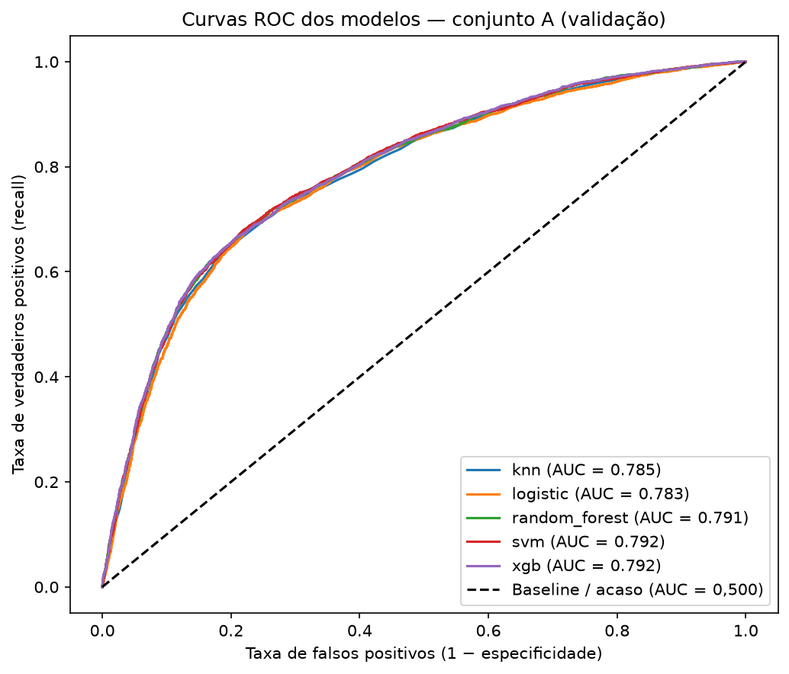

As curvas ROC dos cinco modelos praticamente se sobrepõem e ficam bem acima da diagonal do acaso. Nas curvas Precision-Recall, a precisão média vai de 0,761 (Regressão Logística) a 0,775 (XGBoost), contra cerca de 0,495 do baseline, que é a proporção de doentes.

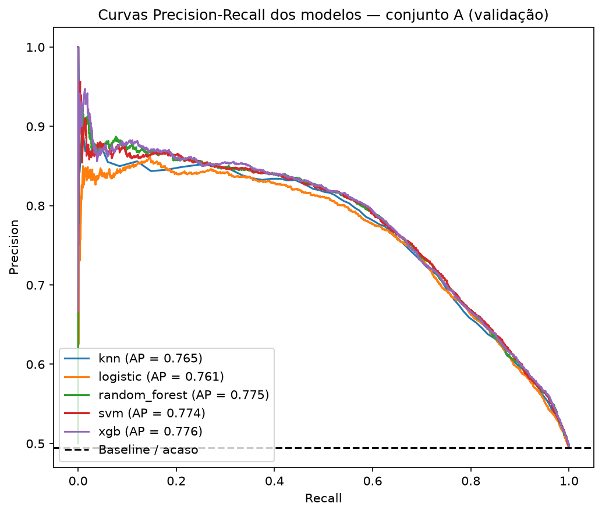

A curva de calibração do XGBoost acompanha a diagonal: em média, a probabilidade prevista difere da frequência real de doença em apenas 1,4 ponto percentual, então a probabilidade pode ser lida como uma estimativa do risco do paciente.

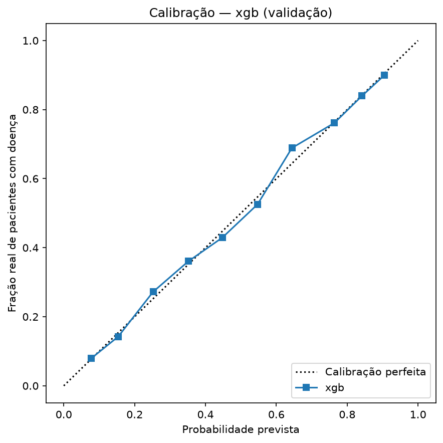

### 6.3 Limiar de decisão

Com o corte padrão (0,50), o XGBoost deixa de sinalizar cerca de 1 em cada 3 doentes (recall de 67,9%). Como esse é o erro mais grave numa triagem, o limiar foi baixado seguindo uma regra definida **na validação**: o maior limiar que mantém o recall em pelo menos 0,80, o que dá **0,36**.

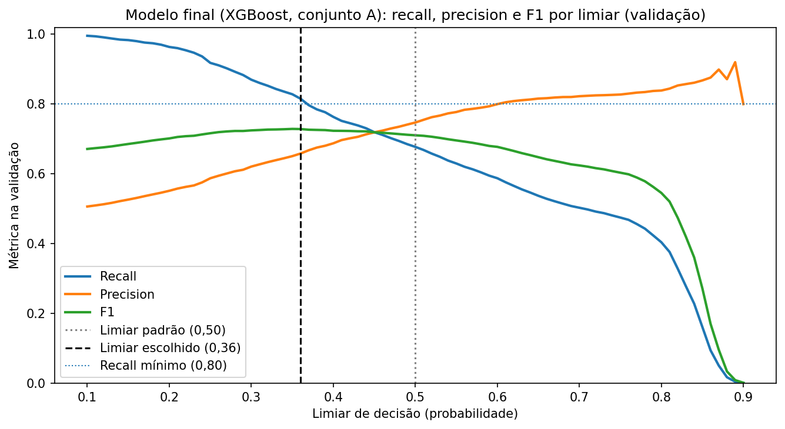

| | Limiar 0,50 | Limiar 0,36 | Diferença |
|---|---|---|---|
| Recall | 67,9% | 81,7% | +13,8 p.p. |
| Precision | 74,5% | 65,8% | −8,7 p.p. |
| Especificidade | 77,3% | 58,4% | −18,9 p.p. |
| Doentes **não sinalizados** por 1.000 pacientes | 159 | 91 | −68 |
| Saudáveis **encaminhados** por 1.000 pacientes | 115 | 210 | +95 |

A cada 1.000 pacientes avaliados, o limiar de 0,36 faz **68 doentes a mais** serem sinalizados, em troca de **95 encaminhamentos extras** de pessoas saudáveis: cerca de 1,4 alarme falso para cada doente a mais encontrado. A troca é aceitável porque os dois erros têm custos diferentes: um doente não sinalizado pode ficar sem tratamento, enquanto um falso positivo custa uma consulta ou um exame a mais, e o médico confirma o diagnóstico.

### 6.4 Resultado final no conjunto de teste

O modelo final é o **XGBoost com o conjunto A**, treinado com treino e validação juntos (58.232 pacientes) e com o limiar de 0,36 fixado antes de se olhar o teste. Ele foi avaliado **uma única vez** em 10.277 pacientes que não participaram de nenhuma etapa anterior (5.086 com doença e 5.191 sem).

| Métrica | Valor |
|---|---|
| AUC ROC | 0,810 |
| Recall | 83,1% |
| Precision | 66,9% |
| F1-score | 74,2% |
| Especificidade | 59,8% |
| Acurácia | 71,3% |

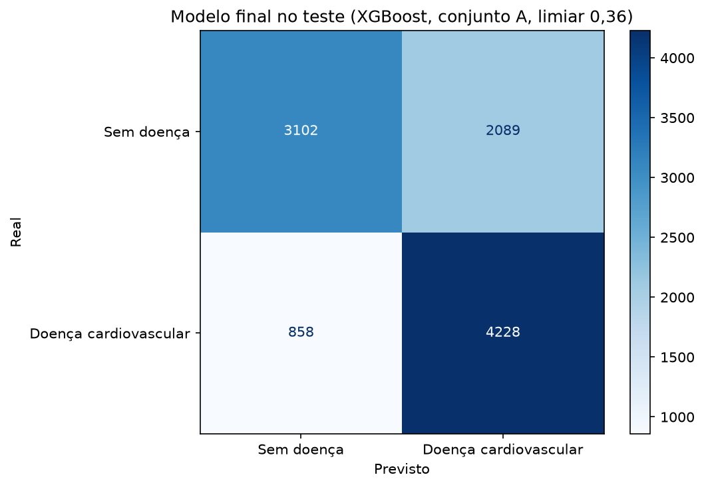

Dos 5.086 pacientes com doença, o modelo sinalizou **4.228** e deixou de sinalizar **858**. Dos 5.191 saudáveis, liberou 3.102 e encaminhou **2.089** sem necessidade. A cada 1.000 pacientes (49,5% doentes), isso significa 411 doentes sinalizados, **83 não sinalizados**, **203 saudáveis encaminhados** e 302 saudáveis liberados. Entre os pacientes sinalizados, 67 em cada 100 realmente têm a doença. O recall de 83,1% atinge a meta de pelo menos 80% definida para a triagem.

A AUC no teste (0,810) é 0,018 maior que a da validação (0,792). Isso não deve ser lido como uma melhora do modelo: o modelo final usou mais dados de treino e o teste é outra amostra de pacientes. Como há uma única divisão dos dados, não há intervalo de confiança que mostre quão estável é essa diferença.

### 6.5 Por que o desempenho para perto de 0,79 de AUC?

Quatro verificações com o XGBoost e o conjunto A indicam que o limite está nas informações disponíveis, e não no algoritmo.

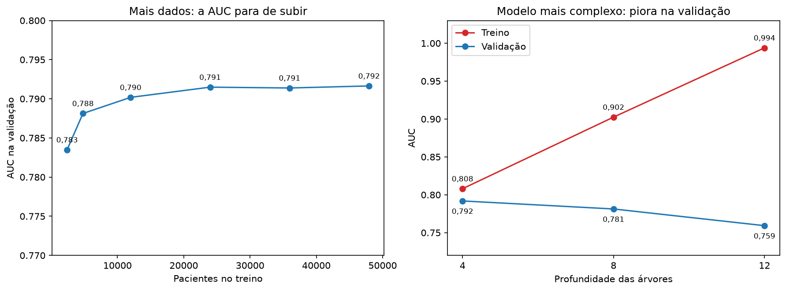

- **Mais dados não ajudam.** A AUC na validação é 0,783 com 2.397 pacientes no treino, 0,790 com 11.988, 0,791 com 23.977 e 0,792 com os 47.955: ela para de subir com um quarto a metade do treino.
- **Modelos mais complexos pioram.** Com árvores de profundidade 4, 8 e 12, a AUC no treino sobe (0,808, 0,902 e 0,994), mas na validação cai (0,792, 0,781 e 0,759): o modelo maior decora ruído em vez de aprender padrões.
- **Combinar modelos não ajuda.** A média das probabilidades de Regressão Logística, Random Forest e XGBoost dá AUC de 0,7906, e a dos cinco modelos, 0,7914, ambas abaixo do melhor modelo sozinho (0,7919).
- **A informação é limitada.** Só as duas pressões arteriais já dão AUC de 0,746, contra 0,792 com as 11 variáveis. Além disso, a pressão foi registrada com pouca precisão: 97% das sistólicas e das diastólicas terminam em zero, e 43% dos pacientes têm exatamente 120/80 ou 140/90.

Essa é uma **inferência** a partir dessas verificações, e não uma prova. O que provavelmente melhoraria o resultado são informações que o dataset não tem: valores numéricos de colesterol e glicose (hoje só há três níveis), uso de medicamentos para pressão (que pode deixar a pressão medida "normal" em um paciente doente), histórico familiar, exames como o eletrocardiograma e uma medida de pressão mais precisa.

## 7. Interpretação (feature importance / SHAP)

Um modelo útil na prática precisa poder ser explicado ao médico. Esta seção mostra quais variáveis o modelo usa, de duas formas: a **importância das variáveis** (T24), que olha o modelo como um todo, e o **SHAP** (T25), que mostra como cada variável empurra o risco de cada paciente.

### 7.1 Quais variáveis mais pesam

A medida mais confiável aqui é a **importância por permutação**: os valores de uma variável são embaralhados entre os pacientes da validação e mede-se o quanto a AUC cai. Se o modelo piora muito, ele dependia daquela variável. Ela vale igual para qualquer modelo e foi calculada para a Regressão Logística, o Random Forest e o XGBoost.

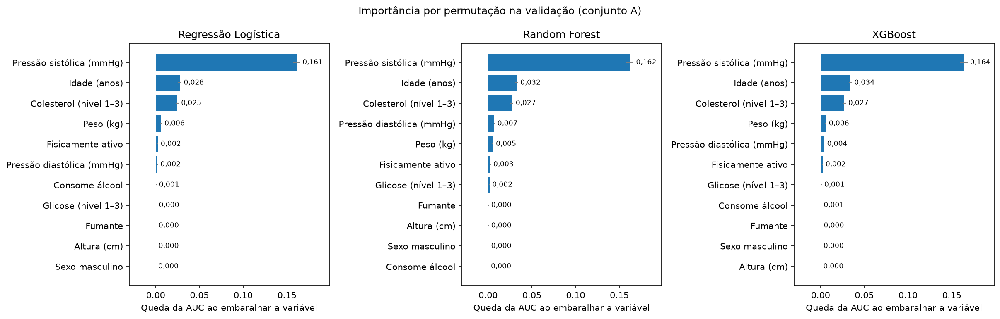

Os **três modelos concordam** nas três variáveis mais importantes e na ordem delas: **pressão sistólica, idade e colesterol**. Embaralhar a pressão sistólica derruba a AUC em 0,161 (Regressão Logística), 0,162 (Random Forest) e 0,164 (XGBoost), de cinco a seis vezes o efeito da idade (0,028, 0,032 e 0,034) e do colesterol (0,025, 0,027 e 0,027). As demais variáveis têm efeito pequeno.

A importância nativa das árvores engana em um ponto: ela coloca a **pressão diastólica** em 2º lugar (20% no Random Forest e 17% no XGBoost), mas pela permutação ela fica em 4º e 5º. É um viés conhecido, porque a diastólica anda junto com a sistólica (correlação de 0,74) e as árvores a usam mesmo quando ela não acrescenta informação.

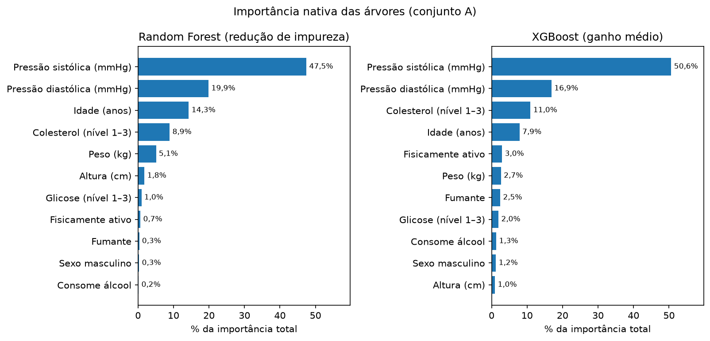

A Regressão Logística permite ler o efeito como **odds ratio**, que mostra por quanto a chance de doença é multiplicada, mantendo as outras variáveis iguais:

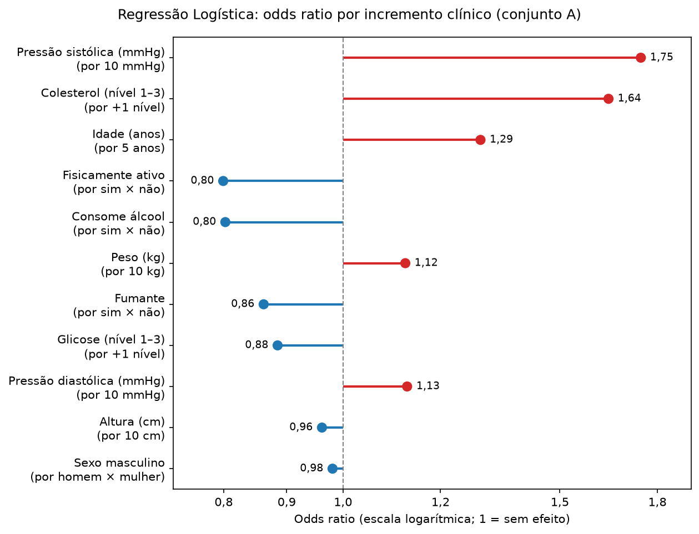

- **pressão sistólica:** a cada 10 mmHg a mais, a chance é multiplicada por **1,75** (75% maior);
- **idade:** a cada 5 anos, por **1,29**;
- **colesterol:** a cada nível (normal, acima, muito acima), por **1,64**;
- **fumo (0,86), álcool (0,80), glicose (0,88) e atividade física (0,80)** ficam abaixo de 1. Para a atividade física, isso é o esperado. Para fumo e álcool, não se deve ler como efeito protetor: são hábitos autodeclarados e já tinham sinal contrário ao esperado na análise exploratória. A glicose anda junto com o colesterol (correlação de 0,40), e com o colesterol no modelo ela pouco acrescenta.

### 7.2 Como cada fator decide (SHAP)

O SHAP mede, para cada paciente, quanto cada variável empurra o risco para cima ou para baixo em relação ao risco médio. Foi calculado no modelo final, em 1.500 pacientes da validação.

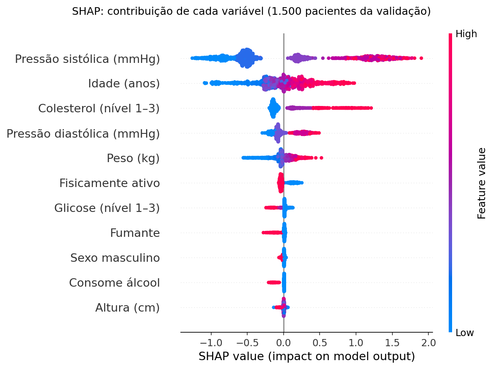

- Pressão sistólica (46%), idade (17%) e colesterol (13%) respondem por cerca de **76%** de toda a contribuição do modelo.
- A pressão sistólica passa a **aumentar** o risco a partir de **130 mmHg**, o mesmo corte de hipertensão estágio 1 da diretriz ACC/AHA; o modelo aprendeu esse limite sozinho, a partir dos dados.
- A idade age de forma gradual e passa a pesar a favor da doença a partir de **55 anos**.
- Hábitos autodeclarados (fumo, álcool e atividade física), altura e sexo têm peso pequeno.

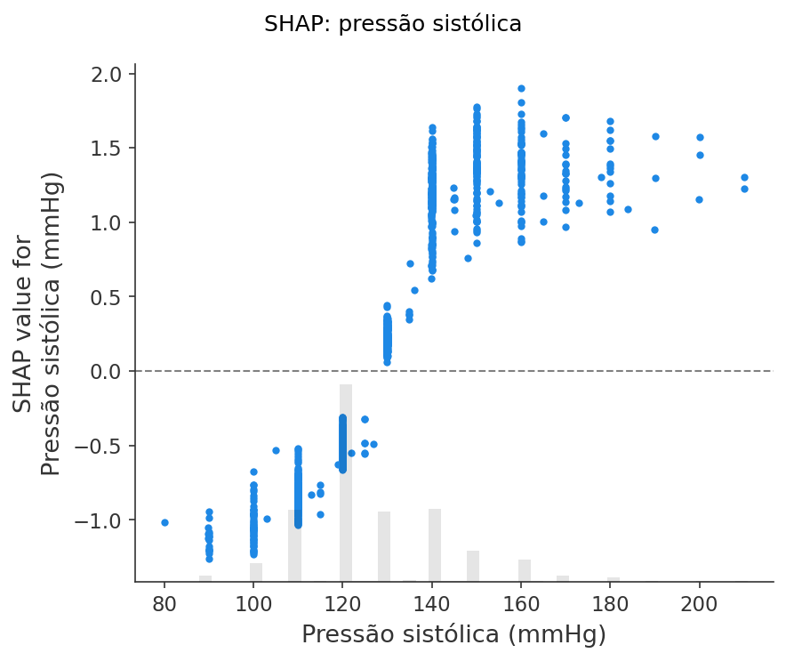

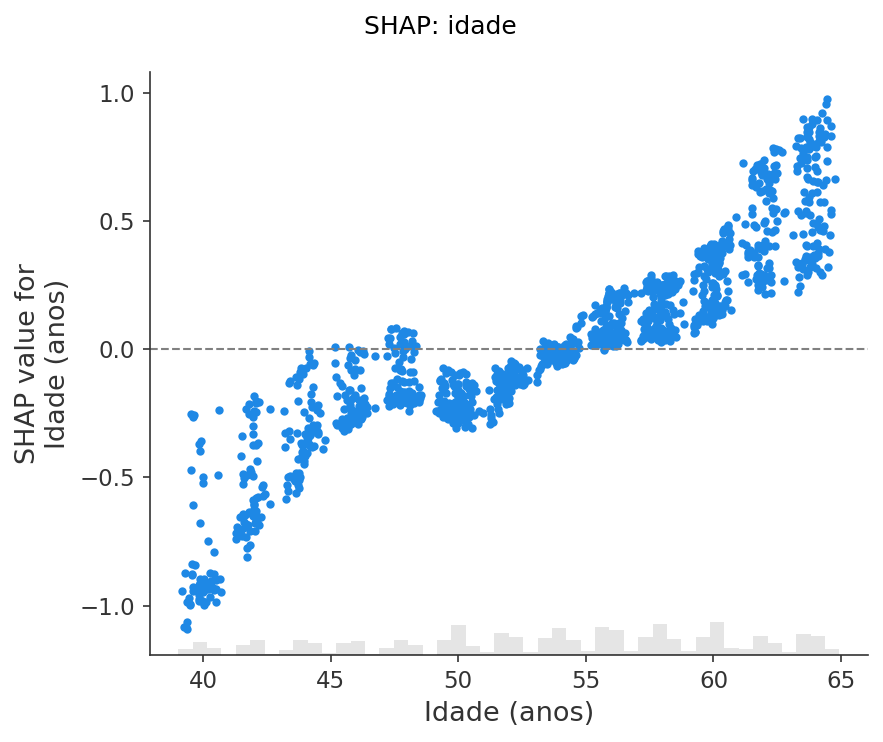

Cada previsão pode ser explicada ao médico, inclusive os erros: os gráficos de cascata abaixo mostram, para um acerto com doença, um acerto sem doença e um doente não sinalizado, quais variáveis levaram o risco até a previsão final.

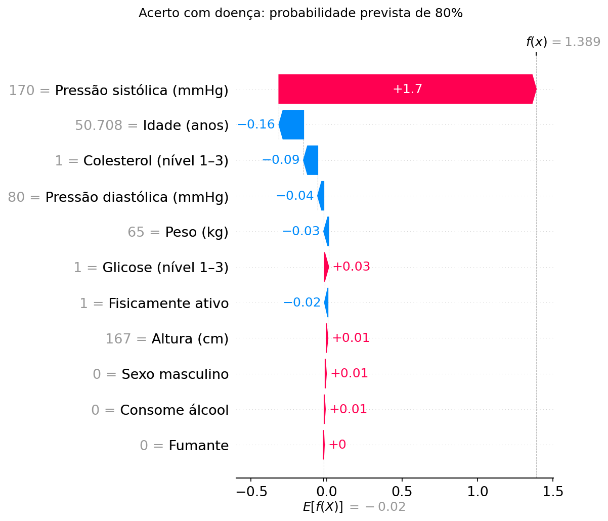

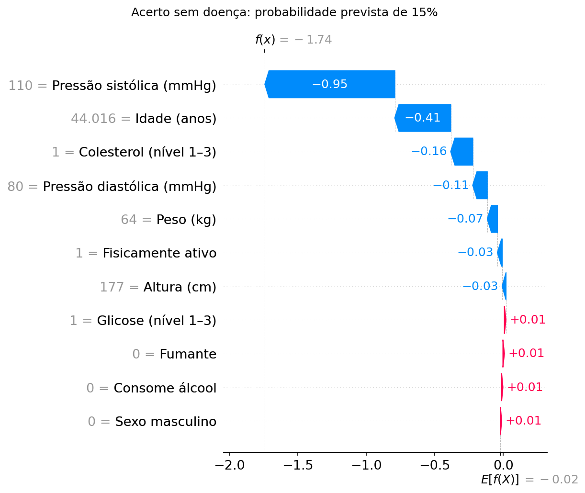

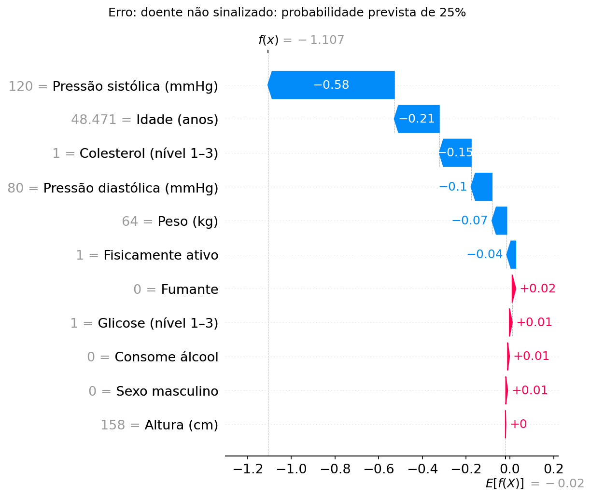

No doente não sinalizado, a pressão (120 mmHg) parecia a de um paciente de baixo risco, e o modelo não enxerga, por exemplo, o uso de remédio para pressão.

### 7.3 O modelo concorda com o conhecimento clínico?

**Em grande parte, sim.** Pressão arterial, idade e colesterol são fatores de risco cardiovascular conhecidos e são as três primeiras variáveis do modelo, na mesma ordem em todos os métodos de permutação e no SHAP. A pressão sistólica domina, com um efeito crescente a partir do mesmo corte usado na prática clínica. O peso aparece em seguida (4ª a 5ª posição), coerente com o excesso de peso como fator de risco, e altura e sexo quase não pesam. A figura resume a posição de cada variável nos sete métodos usados na T24 (três permutações, duas importâncias nativas, o SHAP e o tamanho do efeito na Regressão Logística).

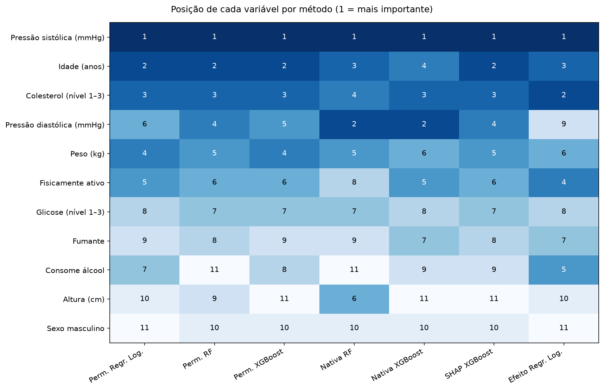

Dois pontos pedem cautela. A **glicose**, um fator de risco clássico, pesa pouco: ela tem só três níveis e anda junto com o colesterol, e uma explicação plausível, não testada aqui, é que parte da informação dela já entre pelo colesterol. Os **hábitos autodeclarados** também pesam pouco, e isso pode refletir a qualidade do dado (subnotificação), e não que eles não importem para o coração.

**Limites.** Importância mostra o que o modelo usa, não o que causa a doença, e variáveis correlacionadas dividem a importância entre si. Os números vêm de uma única divisão dos dados. O modelo é um **apoio à triagem**: o resultado não autoriza o uso isolado para diagnóstico, e a decisão final é sempre do médico.

## 8. Discussão crítica (uso na prática — o médico tem a palavra final)

Esta seção discute se o modelo pode ser usado na prática, onde ele falha e o que seria preciso para melhorá-lo.
Os números de subgrupo vêm de `notebooks/10_analise_erros.ipynb` (T26), calculados na validação com o modelo final
(XGBoost, conjunto A, limiar 0,36) treinado só com os dados de treino.

### 8.1 O modelo pode ser usado na prática? Como?

**Sim, como apoio à triagem, nunca como diagnóstico.** O uso proposto é ordenar a fila: entre os pacientes de uma
consulta de rotina, indicar quais devem fazer exames cardiológicos completos primeiro. No teste, o modelo sinalizou
**83 de cada 100 doentes** (recall de 83,1%), e **67 de cada 100 pacientes sinalizados** realmente tinham a doença
(seção 6.4).

Na prática, isso significa:

- **"Risco alto" é um pedido de investigação, não um diagnóstico.** Um em cada três pacientes sinalizados é saudável e
  será liberado depois dos exames. É o custo aceito para perder menos doentes (seção 6.3).
- **"Risco baixo" não exclui a doença.** O modelo deixa passar cerca de 17% dos doentes. Um paciente com sintomas,
  histórico familiar ou outro motivo clínico de preocupação deve ser investigado, qualquer que seja o resultado.
- **O médico tem sempre a palavra final.** O modelo só vê 11 variáveis; o médico vê o paciente inteiro. A explicação de
  cada previsão (SHAP, seção 7.2) permite ao médico conferir *por que* o modelo deu aquele risco e discordar dele.

### 8.2 Por que o desempenho fica em torno de 73%

A acurácia fica perto de 73% (AUC de 0,79) em todos os cinco modelos, e a seção 6.5 mostra que mais dados ou modelos
mais complexos não mudam isso. A explicação está nas variáveis disponíveis, e não no algoritmo:

- **Variáveis simples.** São dados de uma consulta de rotina; faltam os exames que de fato confirmam a doença.
- **Colesterol e glicose em só 3 níveis** (normal, acima, muito acima). Dois pacientes com colesterol de 250 e de
  320 mg/dL podem cair no mesmo nível, e o modelo não consegue diferenciá-los.
- **Hábitos autodeclarados** (fumo, álcool, atividade física): sim/não, sem quantidade, e com sinal contrário ao
  esperado no fumo e no álcool (seção 3.3), o que indica subnotificação.
- **Erros de registro.** Mesmo depois da limpeza (seção 3.1), a pressão foi anotada de forma arredondada: 97% das
  medidas terminam em zero e 43% dos pacientes têm exatamente 120/80 ou 140/90 (seção 6.5).
- **Falta o tratamento.** Um hipertenso que toma remédio pode ter a pressão "normal" no dia da consulta. Para o
  modelo, ele parece saudável.

### 8.3 Onde o modelo erra (T26)

O desempenho não é igual para todos os pacientes. A figura mostra recall, precision e F1 por subgrupo; em vermelho,
os grupos mais de 0,05 abaixo do geral.

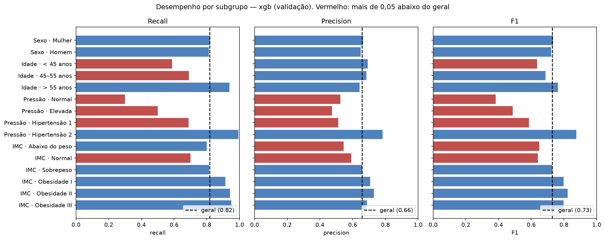

| Subgrupo | Pacientes | % com doença | Recall |
|---|---|---|---|
| Todos | 10.277 | 49,5% | 0,82 |
| Mulheres / homens | 6.757 / 3.520 | 49,3% / 49,8% | 0,82 / 0,81 |
| Idade < 45 anos | 1.533 | 29,9% | **0,59** |
| Idade > 55 anos | 4.640 | 60,1% | 0,94 |
| Pressão normal | 1.487 | 23,9% | **0,30** |
| Hipertensão estágio 2 | 3.490 | 77,3% | 0,99 |
| IMC normal | 3.784 | 39,4% | **0,70** |

- **Não há diferença entre os sexos** (recall de 0,82 nas mulheres e 0,81 nos homens).
- **O modelo falha justamente em quem parece saudável.** Com pressão normal, ele encontra só **3 em cada 10 doentes**;
  abaixo de 45 anos, 6 em cada 10. Esses grupos têm menos doença, e os doentes deles se parecem com os saudáveis nas
  variáveis disponíveis.
- **Os doentes não sinalizados parecem saudáveis.** Dos 929 doentes que o modelo deixou passar na validação, 27% têm
  pressão normal (contra 3% dos doentes que ele encontrou) e 30% não têm nenhum fator de risco aparente (contra 11%).
  Na média, eles têm pressão, idade, IMC e colesterol muito próximos dos pacientes saudáveis.

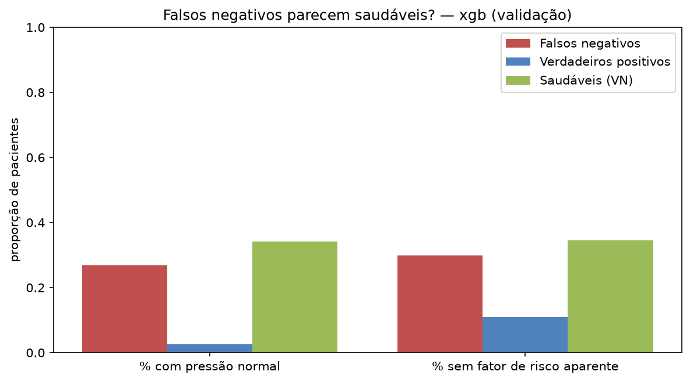

**Consequência prática:** em paciente jovem, com pressão normal ou sem fatores de risco aparentes, um resultado de
risco baixo vale pouco. Nesses grupos, a avaliação clínica deve pesar mais do que o modelo.

### 8.4 Limitações dos dados

- **Uma única fonte, pouco documentada.** O dataset vem do Kaggle, sem informação clara sobre o país, os hospitais, o
  período de coleta ou como o diagnóstico foi feito. Não dá para saber a quem os resultados se aplicam.
- **Amostra que não representa a população geral:** 65% são mulheres, todos têm entre 30 e 65 anos, e metade tem a
  doença, uma proporção muito maior do que na população.
- **Dados transversais.** Tudo foi registrado no mesmo exame, junto com o diagnóstico. O modelo identifica **quem já
  tem** a doença; ele **não prevê quem vai ter** nos próximos anos. Para isso seria preciso acompanhar pacientes ao
  longo do tempo.
- **Uma única divisão dos dados.** Os resultados vêm de uma divisão treino/validação/teste, sem intervalos de
  confiança; diferenças pequenas entre modelos (menos de 0,01 de AUC) não devem ser lidas como reais.

### 8.5 Riscos de usar o modelo em outras populações

- **Menos doença, mais alarmes falsos.** Nos dados, metade dos pacientes tem a doença. Numa população em que só 10%
  têm, mantendo a mesma sensibilidade e especificidade do teste, só **19 de cada 100 pacientes sinalizados** seriam
  doentes (contra 67 aqui), e o risco estimado pelo modelo ficaria superestimado. O limiar e a calibração teriam de ser
  revistos com dados locais.
- **Idades fora da faixa.** O modelo nunca viu pacientes com menos de 30 ou mais de 65 anos; o resultado nessas idades
  é uma extrapolação.
- **Outros hábitos de registro.** Uma clínica que mede a pressão com mais precisão, ou que registra colesterol em
  mg/dL, produz dados diferentes dos usados no treino.
- **Antes de usar em qualquer serviço**, o modelo precisa ser testado nos pacientes daquele serviço e acompanhado
  depois da implantação, com revisão periódica dos casos não sinalizados.

### 8.6 Próximos passos

1. **Variáveis clínicas mais ricas:** colesterol (LDL, HDL) e glicemia em valores contínuos, uso de anti-hipertensivos
   e estatinas, histórico familiar, tabagismo em maços-ano e exames como o eletrocardiograma (o extra da seção 10 é um
   primeiro passo nessa direção).
2. **Validação externa:** testar o modelo em dados de outro hospital ou país, com a proporção real de doentes, antes de
   qualquer uso.
3. **Dados longitudinais:** acompanhar pacientes ao longo do tempo para prever risco futuro, como fazem os escores
   clínicos de risco cardiovascular.
4. **Avaliar com o médico:** medir, num estudo piloto, se a priorização reduz o tempo até o diagnóstico sem aumentar
   demais a fila de exames.

## 9. Conclusão

Com dados de uma consulta de rotina, é possível construir um apoio à triagem cardiovascular útil, mas com limites
claros. Depois de limpar 1.491 registros impossíveis, os cinco algoritmos testados chegaram ao mesmo patamar de AUC na
validação (0,783 a 0,792), o que indica que o limite está nas variáveis disponíveis e não no algoritmo (seção 6.5).

O modelo final, um XGBoost com as 11 variáveis originais e o limiar de decisão ajustado para 0,36, foi avaliado uma única
vez no teste: AUC de 0,810 e **recall de 83,1%**, acima da meta de 80% definida para a triagem. A cada 1.000 pacientes,
ele deixa de sinalizar cerca de 83 doentes e encaminha cerca de 203 pessoas saudáveis para exames de confirmação. As
decisões são explicáveis: pressão sistólica, idade e colesterol respondem pela maior parte do risco estimado, em
concordância com os fatores de risco conhecidos, e a pressão passa a pesar a partir de 130 mmHg (seção 7).

O uso indicado é **ordenar a fila de exames**, nunca diagnosticar. O modelo falha justamente em quem parece saudável
(pacientes jovens ou com pressão normal, seção 8.3), foi treinado com uma amostra de uma única fonte e não prevê doença
futura. Antes de qualquer uso real, ele precisaria de variáveis clínicas mais ricas e de validação em dados de outros
serviços. A decisão final é sempre do médico.

## 10. Extra: diagnóstico por imagem de ECG (CNN)

Complemento opcional do desafio: classificação de **imagens de eletrocardiograma (ECG)** com redes neurais convolucionais,
no pacote `src/cardio_visual/` (separado do projeto tabular, com a mesma organização). O tema é o mesmo do projeto
principal (doença cardiovascular), agora a partir de outra fonte de dados: o ECG impresso de 12 derivações.

### 10.1 Problema e dataset

O objetivo é uma **triagem**: dado o ECG de um paciente, indicar se ele parece normal ou se há sinais de batimento
anormal, de infarto em curso ou de infarto prévio, para priorizar a leitura do cardiologista. O dataset é o
[Cardiovascular ECG Images](https://www.kaggle.com/datasets/jayaprakashpondy/ecgimages/data) (Kaggle), com 4 classes:
normal, batimento anormal, histórico de infarto e infarto.

A verificação do dataset (`notebooks/cnn_01_eda_imagens.ipynb`, figura `cnn_eda_duplicatas.png`) mudou o tamanho real
do problema:

- O zip tem **1.376 imagens, mas só 491 diferentes**: as 448 imagens da pasta `test/` são **cópias** de imagens de
  `train/`, e o próprio `train/` repete imagens (cada ECG de infarto aparece até 8 vezes). Avaliar no `test/` original
  mediria o modelo em imagens que ele já viu.
- Imagens únicas por classe: batimento anormal 233, normal 142, histórico de infarto 86 e **infarto só 30**.
- Nenhum arquivo corrompido; todas as imagens são relatórios impressos de 2213 × 1572 px, com o mesmo layout.

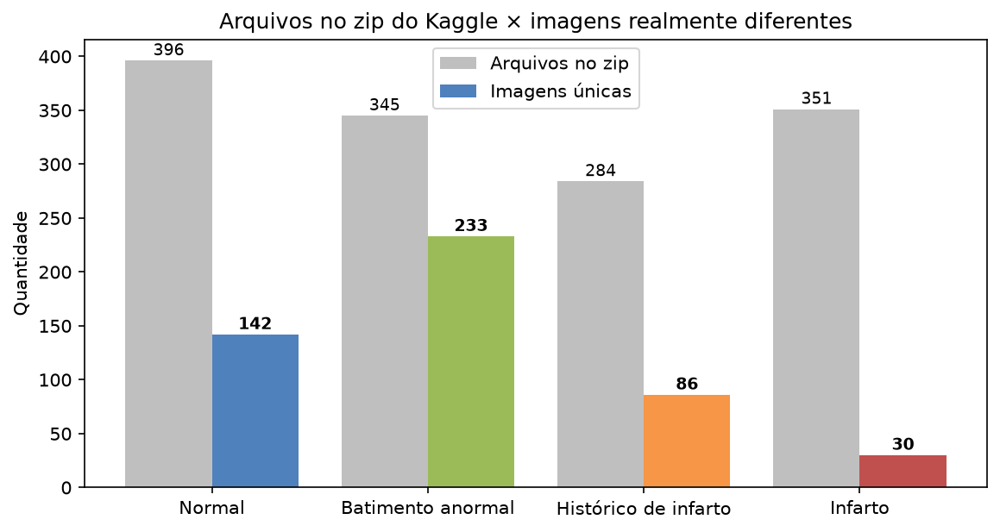

Por isso usamos **só as imagens únicas** e fizemos a nossa própria divisão. Antes dela, **1 imagem de cada classe foi
sorteada e reservada para um teste cego** (`data/demo`, para o professor e a apresentação). As outras 487 foram divididas
em **70/15/15, estratificado, com `SEED = 42`** (o mesmo critério do projeto tabular): 340 de treino, 73 de validação e
74 de teste, com só 4 imagens de infarto na validação e 4 no teste.

### 10.2 Pré-processamento

- **Recorte da grade do traçado** (`RecorteGrade`): a grade ocupa a mesma posição nas 491 folhas (pixels 68 a 2176 na
  horizontal e 283 a 1517 na vertical). Fora dela há só texto impresso: ID do paciente, data, hora e frequência cardíaca.
  Esse texto não é o ECG e poderia virar **atalho** para o modelo, então é removido antes de tudo.
- Redimensionamento para 448 × 448 px (cada derivação fica com ~110 px de largura, contra ~55 px em 224; figura
  `cnn_eda_resolucao.png`) e normalização do ImageNet, necessária para o transfer learning.
- **Aumento de dados só no treino**: rotação de até 2°, deslocamento de 2%, escala de ±2% e brilho/contraste. **Sem giro
  horizontal ou vertical**: no ECG o eixo horizontal é o tempo, e inverter a imagem cria um traçado que não existe.
- **Pesos de classe** na função de perda, para compensar o desbalanceamento.

### 10.3 Modelos e por quê

- **CNN simples (do zero)**: 4 blocos convolucionais e pooling global. É o baseline: mostra o que uma rede pequena
  aprende sem conhecimento prévio.
- **ResNet18 com transfer learning**: rede pré-treinada no ImageNet, com a última camada trocada para as 4 classes e todo
  o corpo ajustado (fine-tuning). Com poucas centenas de imagens, reaproveitar filtros de bordas e formas já aprendidos é
  a forma mais realista de chegar a um bom resultado.

Treino com Adam (taxa 0,001, lotes de 32), até 20 épocas e **parada antecipada pelo F1 macro da validação** (paciência de
5 épocas; com F1 empatado, vale a menor perda). A escolha do modelo usou **só a validação e a validação cruzada**; o teste
foi usado **uma única vez**, no modelo final. Na CPU, o treino do ResNet18 leva ~6 min em 224 px e ~25 min em 448 px.

### 10.4 Resultados

**Validação** (73 imagens, `results/cnn_val_results.csv`):

| Modelo | Acurácia | F1 macro (IC 95%) | Recall macro |
|---|---|---|---|
| CNN simples, 224 px | 0,62 | 0,40 (0,33 a 0,50) | 0,43 |
| ResNet18, 224 px | 0,86 | 0,79 (0,58 a 0,92) | 0,75 |
| **ResNet18, 448 px** | **0,90** | **0,85** (0,66 a 0,96) | **0,83** |

**Validação cruzada** (5 folds sobre treino + validação, 224 px, `results/cnn_cv_results.csv`): ResNet18 com F1 macro
**0,83 ± 0,05** e CNN simples com **0,60 ± 0,09**; o recall do infarto foi 0,72 ± 0,11 e 0,40 ± 0,14. O transfer
learning é claramente superior. A vantagem do 448 px sobre o 224 px (0,85 contra 0,79 na validação) é do tamanho de
cerca de um desvio-padrão da validação cruzada: é uma evidência fraca, e a escolha do 448 px também se apoia na EDA
(mais detalhe do traçado por derivação).

**Teste, modelo final ResNet18 448 px** (74 imagens, avaliação única; `results/cnn_test_results.csv`, figura
`cnn_cm_resnet18_448_test.png`):

| Classe | Precision | Recall | F1 | Imagens |
|---|---|---|---|---|
| Batimento anormal | 0,94 | 0,97 | 0,96 | 35 |
| Histórico de infarto | 0,87 | 1,00 | 0,93 | 13 |
| Infarto | 1,00 | **0,50** | 0,67 | 4 |
| Normal | 1,00 | 0,95 | 0,98 | 22 |

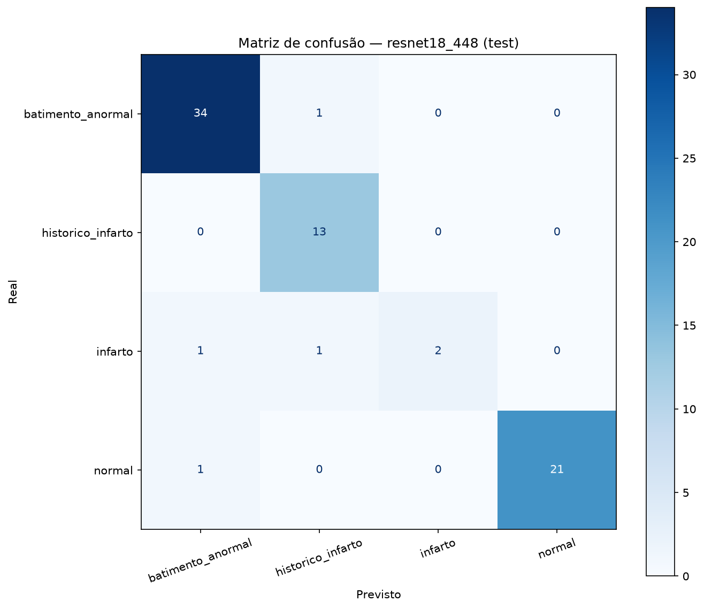

Acurácia 0,95, **F1 macro 0,88 (IC 95% de 0,70 a 0,99)** e AUC média de 0,99. Na **visão de triagem** (normal ×
qualquer alteração), o modelo **sinalizou 100% dos ECGs alterados** com especificidade de 0,95.

**Escolha da métrica.** Numa triagem, o erro mais grave é o falso negativo (um ECG alterado tratado como normal). Por
isso a métrica principal é o **recall por classe** (e o recall da visão binária), acompanhado de precision, F1 e AUC; a
acurácia sozinha esconderia o erro nas classes pequenas. Como o teste tem poucas imagens, os resultados vêm com
**intervalo de confiança** (bootstrap).

**Teste cego** (`notebooks/cnn_03_projeto_imagens.ipynb`): as 4 imagens reservadas foram classificadas corretamente (4
de 4); a de infarto teve a menor confiança (61%). Com 4 imagens isso é uma demonstração, não uma medida de desempenho.

### 10.5 Interpretação (Grad-CAM)

Para imagens, o Grad-CAM cumpre o papel da feature importance/SHAP do projeto tabular: um mapa de calor mostra as regiões
que mais pesaram na decisão (`notebooks/cnn_02_interpretacao.ipynb`, figura `cnn_gradcam_val.png`).

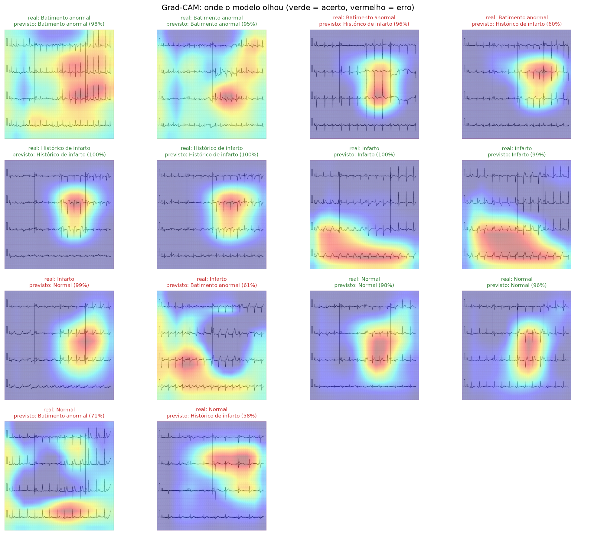

- O calor cai sobre **derivações específicas** do traçado, e não sobre a grade em branco ou sobre texto (já removido pelo
  recorte). Nos acertos de histórico de infarto, ele se concentra na região das precordiais V1 a V3; nos de infarto, na
  tira de ritmo e nas derivações inferiores.
- A medida objetiva (quanto do calor cai sobre os pixels do traçado, comparado à área que eles ocupam) dá uma razão de
  1,11. O número fica perto de 1 também porque o mapa tem só 14 × 14 células e espalha o calor pela vizinhança do traçado.
- Na validação houve 7 erros em 73 imagens, 3 deles com confiança de 80% ou mais. O pior foi um **infarto classificado
  como normal com 99% de confiança**.

O Grad-CAM é uma pista coerente com a leitura de um ECG (cada alteração aparece em derivações próprias), não uma prova de
que o modelo reconhece a onda certa.

### 10.6 Discussão crítica

**O modelo pode ser usado na prática? Como?** Como **apoio à triagem**: ordenar a fila de ECGs para que os que parecem
alterados sejam lidos primeiro. Na visão binária, ele não deixou passar nenhum ECG alterado no teste. **Não** deve ser usado
para descartar infarto: a classe infarto tem só 30 imagens, o recall no teste foi de 2 em 4, e houve um infarto
classificado como normal com 99% de confiança na validação. **O cardiologista tem sempre a palavra final.**

Limitações:

- **Dataset pequeno e repetitivo**: 491 ECGs diferentes, e os resultados têm intervalos de confiança largos (o F1 macro no
  teste pode estar entre 0,70 e 0,99).
- **Uma única fonte**: imagens do mesmo software e, provavelmente, do mesmo hospital; o desempenho em outro aparelho ou
  outra população não foi medido.
- **ECG impresso, não o sinal original**: a imagem perde resolução de tempo e amplitude que um cardiologista ou um
  modelo de sinal usariam.
- **Sem dados clínicos**: o modelo não sabe idade, sintomas ou exames anteriores, que o médico usa junto com o ECG.

Próximos passos: mais imagens de infarto, validação externa (outro hospital), modelos sobre o sinal do ECG e treino em
GPU para testar resoluções maiores.

### 10.7 Conclusão do extra

Com transfer learning (ResNet18), o modelo chega a F1 macro de 0,88 no teste e separa ECGs normais de alterados com
recall de 100% e especificidade de 95%, mas com incerteza grande e fraqueza clara na classe infarto. Ele complementa o
projeto tabular como uma segunda fonte de informação para a triagem cardiovascular, sempre como apoio à decisão médica.
